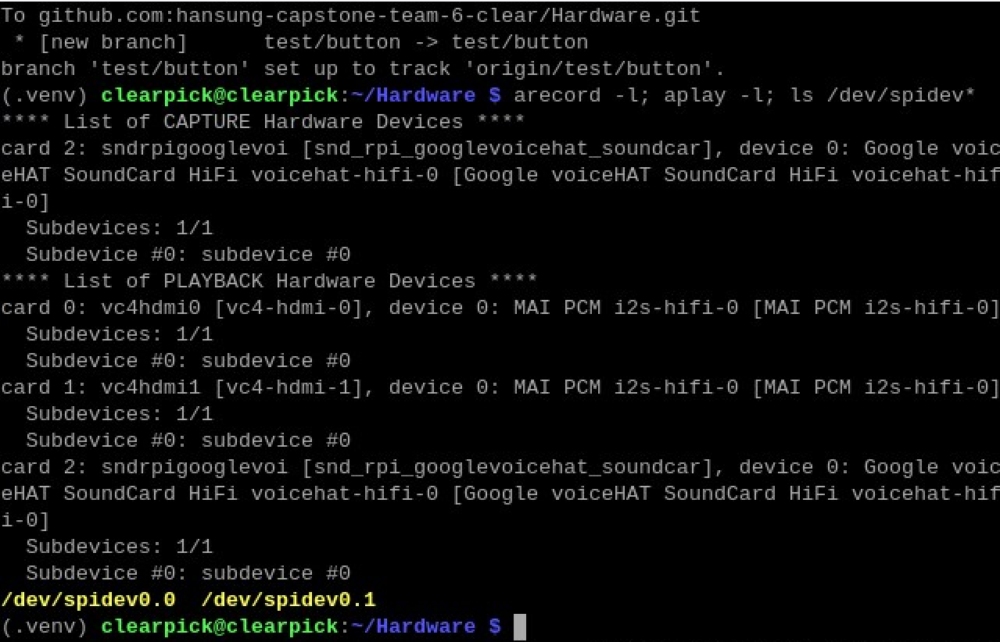
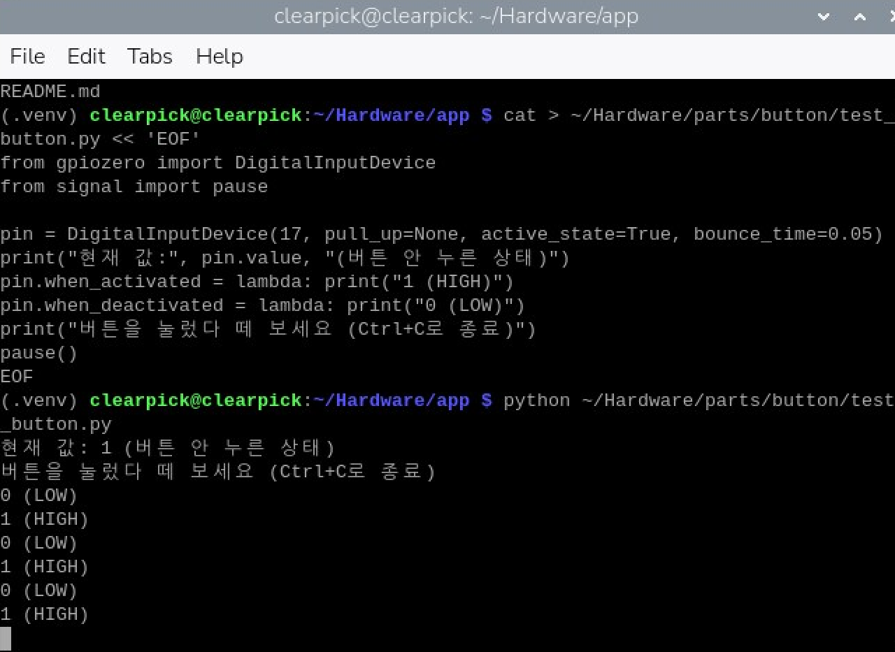

# Pi 세팅 · 버튼 테스트 작업 정리

2026-10-15 · 김지훈

## 요약

Pi 기본 세팅의 완료 기준 4개를 모두 통과했고, GPIO17 버튼 동작을 확인해 PR로 올렸다. 남은 큰 일은 오디오(마이크·앰프) 실물 테스트다.

| 작업 | 결과 |
| --- | --- |
| 노트북 개발 환경 + pytest | 6 passed, 수집 오류는 Issue #2로 등록 |
| 노트북 백엔드 ↔ 앱 WS 연결 | 연결 성공 (`BACKEND_URL=http://127.0.0.1:8000`) |
| README Windows 실행 방법 | PR `docs/windows-app-run` 생성 |
| contracts.md 검토 | 코멘트 남김 |
| Pi 기본 세팅 | 완료 기준 4개 통과 |
| 버튼 테스트 | active-low 확인, PR `test/button` |

### 각 작업 설명

**1. 노트북 개발 환경 + pytest**
팀 백엔드 코드를 노트북에서 실행할 수 있게 준비하고, 자동 테스트를 돌려 6개 통과를 확인했다. 실패한 1개는 원인을 찾아 Issue #2로 등록했다.
→ Pi 없이도 하드웨어 코드를 시험해 볼 "연습 상대"를 만든 것이다.

**2. 노트북 백엔드 ↔ 앱 WS 연결**
백엔드와 하드웨어 앱을 동시에 켜서 WebSocket으로 연결되는 것을 확인했다.
→ 마감 알림이 오는 통로가 코드상으로 작동하는지 미리 검증한 것이다.

**3. README Windows 실행 방법**
Windows에서 앱을 실행하는 방법을 문서로 정리해 PR을 올렸다.
→ 팀원이 같은 오류(실행 정책, localhost)를 반복하지 않게 하기 위해서다.

**4. contracts.md 검토**
팀 인터페이스 약속 문서에 하드웨어 입장의 의견을 남겼다.
→ 백엔드와 Pi가 주고받는 데이터 형식이 안 맞는 문제를 미리 막기 위해서다.

## Pi 기본 세팅

OS는 Raspberry Pi OS **trixie**(Debian 13)다. 설계 문서의 bookworm보다 최신이지만 진행에 문제는 없었다. 나중에 문제가 생기면 원인을 찾는 단서가 되므로 기록해 둔다.

1. `sudo apt update`: 이미 최신 상태
2. `sudo apt install -y git python3-venv mpg123 fonts-nanum`: 설치 완료
3. `/boot/firmware/config.txt` 수정 (원본은 `config.txt.bak`으로 백업)
    - `#dtparam=spi=on` → `dtparam=spi=on`
    - `dtparam=audio=on` → `dtparam=audio=off`
    - 끝에 `[all]`과 `dtoverlay=googlevoicehat-soundcard` 추가
4. 재부팅
5. `git clone git@github.com:hansung-capstone-team-6-clear/Hardware.git`
6. `app/`에서 `python3 -m venv --system-site-packages .venv` → `pip install -r requirements.txt` → `cp .env.example .env`

### 각 단계 설명

**① `apt update`**: 설치 가능한 프로그램 목록을 새로고침한다. 최신 버전을 받기 위한 준비다.

**② 패키지 설치**
- `git`: GitHub에서 코드를 받는 도구
- `python3-venv`: 프로젝트 전용 파이썬 공간을 만드는 도구
- `mpg123`: TTS 음성(mp3)을 스피커로 재생하는 프로그램
- `fonts-nanum`: LCD에 한글을 표시하는 폰트

**③ config.txt 수정**: Pi가 부팅할 때 읽는 하드웨어 설정 파일이다.
- `spi=on`: LCD와 통신하는 통로를 켠다.
- `audio=off`: 내장 오디오를 끈다. 내장 오디오가 LED와 같은 PWM 신호를 써서 충돌하기 때문이다.
- `googlevoicehat`: 마이크·앰프와 통신하는 I2S 통로를 켠다.

**④ 재부팅**: config.txt는 부팅할 때만 읽히므로 재부팅해야 적용된다.

**⑤ Hardware 레포 clone**: 팀 하드웨어 코드를 Pi로 내려받는다.

**⑥ venv, pip install, .env**
- `venv`: 이 프로젝트 전용 파이썬 공간이라 다른 프로그램과 섞이지 않는다.
- `--system-site-packages`: Pi에 이미 깔린 GPIO 도구를 venv 안에서도 쓸 수 있게 한다.
- `pip install`: 코드가 쓰는 라이브러리를 설치한다.
- `.env`: 백엔드 주소 같은 설정값을 담는 파일이다. 커밋하지 않는다.

### 완료 기준

| 완료 기준 | 결과 | 의미 |
| --- | --- | --- |
| SSH 접속 | 통과 | 노트북에서 Pi를 원격으로 조작할 수 있음 |
| `arecord -l` / `aplay -l`에 I2S 카드 | 통과: card 2 `sndrpigooglevoi` | 마이크·앰프 통로가 열림 |
| `/dev/spidev0.0` | 통과: `spidev0.0`, `spidev0.1` | LCD 통로가 열림 |
| `pip install -r requirements.txt` | 통과: 오류 없음 | 앱을 실행할 준비가 끝남 |

카드가 보인다고 마이크·스피커가 작동하는 것은 아니다. 실제 작동은 부품이 온 뒤 녹음·재생으로 확인해야 한다. 테스트할 때는 `-D plughw:2,0`을 쓴다.

RealVNC가 유료 결제를 요구해서 쓰지 않기로 했다. 화면이 필요하면 TigerVNC를 쓰고, 작업은 SSH로 한다.

## 버튼 테스트

3핀 버튼 모듈은 평소 1이고 누르면 0이 된다(active-low). 3번 눌러서 3번 모두 정확히 감지했고 채터링은 없었다.

| 모듈 핀 | Pi 핀 |
| --- | --- |
| VCC | Pin 1 (3.3V), 5V 연결 금지 |
| GND | Pin 6 |
| IN | Pin 11 (GPIO17) |

- 테스트 코드: `parts/button/test_button.py` (`DigitalInputDevice`로 0/1 값 출력)
- 앱 코드에는 `Button(17, pull_up=True)`를 그대로 쓸 수 있다.
- 결과는 `parts/button/README.md`에 기록했다.
- 브랜치 `test/button` → 커밋 → push → PR, 리뷰어는 claire-lemon

### 설명

**배선**: 버튼 모듈에 전원을 주고 버튼 신호를 GPIO17로 받는다. Pi GPIO는 3.3V용이므로 VCC를 5V에 연결하면 Pi가 망가질 수 있다.

**결과**: 버튼은 녹음을 시작하는 스위치라서 정확한 감지가 가장 중요하다. 앱 코드 설정 `Button(17, pull_up=True)`가 이 버튼과 맞는다는 것도 확인했다.

**test_button.py, README 기록**: 다른 팀원도 같은 테스트를 재현할 수 있게 레포에 남겼다.

**브랜치 → PR**: `main`을 직접 고치지 않고 `test/button` 브랜치에서 작업한 뒤 리뷰를 요청했다. 실수가 팀 원본 코드에 바로 들어가는 것을 막는 팀 규칙이다.

## 남은 일

- [ ] 오디오 부품 도착 상황을 팀에 공유하기 (늦어지면 팀 일정에도 영향)
- [ ] 부품이 오면 마이크·앰프를 배선하고 5초 녹음·재생 테스트 (`plughw:2,0`). 10/18(일)까지 안 되면 USB(Plan B)로 전환
- [ ] README PR과 버튼 PR이 승인되면 머지
- [ ] 김리윤과 LED·LCD 역할 나누기
- [ ] 발열 대비: `vcgencmd measure_temp`로 온도 확인, 방열판 추가, 하우징 통풍구 요청
